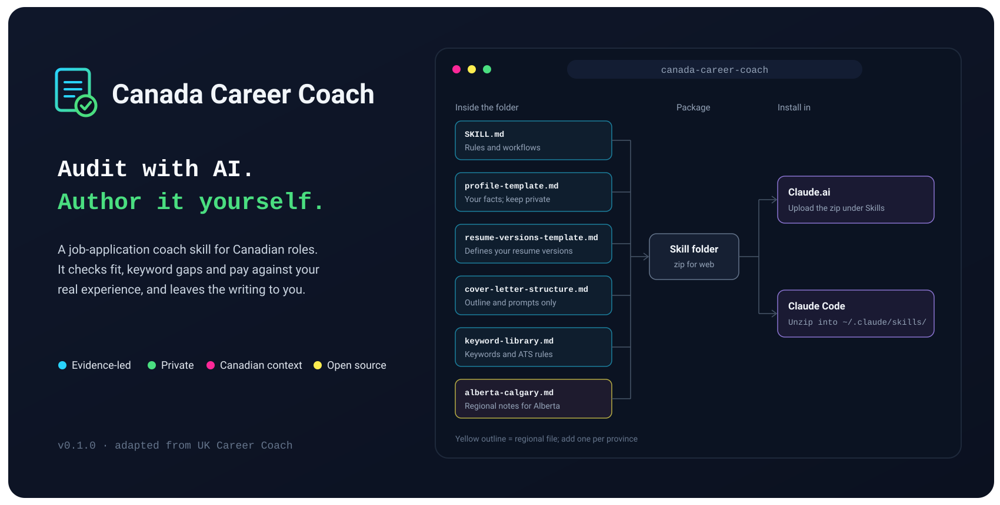

<p align="center">
  
</p>
# Canada Career Coach

An open AI skill for Canadian job applications. It evaluates a job posting
against your profile, maps keyword gaps, recommends which resume version to
use, and proofreads. It includes regional notes for Alberta and Calgary.

Adapted from [UK Career Coach](https://github.com/NotXinrui/UK-Career-Coach)
by NotXinrui, under the MIT License.

**Language** English (Canadian) · **Works with** Claude

## What it does

| Give it | It returns |
|---|---|
| A job posting (pasted or linked) | A six-part fit assessment, an ATS keyword gap list, and a salary check against current Canadian sources |
| One or more resumes | A side-by-side comparison, a recommended version, before-and-after suggestions, and consistency checks |
| A cover letter request | Three questions first, then a five-paragraph outline with prompts. Prose only if you ask |
| A resume or letter to proofread | Spelling, tense, passive voice, vague numbers, formatting, and personal details Canadian resumes leave out |
| Counts by application stage | A plain reading of what the funnel shows, and what it cannot show |

## Principles

1. **AI audits; you author.** Facts, claims and final wording stay with you.
2. **Built not to invent.** It is instructed never to make up achievements,
   tools, titles, numbers or dates, and to report gaps instead. This is an
   instruction, not a guarantee, so check every line.
3. **Blockers first.** Citizenship, security clearance, language, location,
   seniority and pay mismatches are flagged before anything else.
4. **Not immigration or legal advice.** It flags work-authorization
   requirements but does not interpret immigration rules. Check with
   official sources such as IRCC.
5. **You control your files.** Your profile is plain Markdown that you keep
   and edit. What you paste or upload is sent to the AI provider you use.

## What is different from the UK version

- Canadian spelling and resume conventions (no photo, date of birth,
  marital status or SIN; Letter-size paper).
- Six evaluation dimensions, adding work authorization and clearance, and
  location and language (including English–French bilingualism and
  province-limited remote roles).
- Guidance on "Canadian experience" requirements and on presenting
  experience from employers outside Canada.
- Canadian salary sources (Job Bank, provincial data, public-sector pay
  scales) and provincial pay-disclosure differences.
- Keyword banks for IT support, application support, junior web
  development, cloud and system administration, product and operations, and
  business and data analysis.
- Regional notes for Alberta and Calgary, in a separate file so other
  provinces can be added the same way.

## Quick start

1. **Install** the skill (below).
2. **Personalize it first** (below). This step makes it useful, and it needs
   your resume.
3. **Use it.** Paste a job posting and ask, for example: *"Assess this role
   against my profile and tell me which resume version to use."*

## Install

Download `canada-career-coach.zip`. It contains only the skill folder.

| Where | How |
|---|---|
| Claude.ai | Turn on code execution, then upload the zip under Skills in Settings. Menu names change, so see Anthropic's help centre if you cannot find it. |
| Claude Code | Unzip into `~/.claude/skills/` (personal) or `.claude/skills/` (per project). |

These routes follow the original project's instructions. Confirm them
against the official documentation, since they change.

## Personalize it first

The skill ships with blank templates, so out of the box it is generic. After
installing, upload your current resume and any tailored versions, then paste:

```text
Personalize the canada-career-coach skill for me using my resume.

1. Fill references/profile-template.md from my resume and save it as
   references/profile.md, leaving the template untouched. Ask me about
   anything missing, such as work authorization, salary floor, target roles
   and locations. Do not invent or infer facts.
2. Propose two to four resume versions using
   references/resume-versions-template.md and save them as
   references/resume-versions.md.
3. Show me every change as before and after, and wait for my approval
   before saving anything.
```

Review the result line by line. The coach treats everything in your profile
as fact.

Before uploading, consider removing your phone number and home address. Never
include your SIN, date of birth, or passport or permit numbers. Keep
`profile.md` and `resume-versions.md` out of any public repository; the
`.gitignore` in this repo already excludes them.

## Repository layout

```
.
├── README.md
├── LICENSE
├── .gitignore
├── canada-career-coach.zip          installable skill
└── canada-career-coach/
    ├── SKILL.md                     rules and workflows the coach follows
    └── references/
        ├── profile-template.md            blank profile fields
        ├── resume-versions-template.md    how to define your resume versions
        ├── cover-letter-structure.md      outline and prompts only
        ├── keyword-library.md             starting keywords and ATS rules
        └── alberta-calgary.md             regional notes for Alberta
```

## Limitations

- **Early version.** It has not yet been tested widely.
- **Only as good as your inputs.** The coach works from the resume, profile
  and postings you give it, and cannot check them.
- **Market data goes stale.** The skill asks for current sources and dates;
  verify anything it cites. Regional notes were last checked in November
  2026.
- **Keyword banks are seeds.** Confirm them against real postings.
- **English only.** French and Quebec-specific guidance are not yet
  supported.
- **Regional notes cover Alberta only.** Other provinces can be added as
  separate reference files.

## Privacy and responsibility

Do not commit your profile, resume or employer-confidential material to a
public repository. Anything you paste or upload is processed by the AI
provider you use, so read their data and retention settings first. This
skill is not career, legal or immigration advice. It is an independent
project and is not affiliated with or endorsed by Anthropic.

## Credits

Based on [UK Career Coach](https://github.com/NotXinrui/UK-Career-Coach) by
NotXinrui. The principles, workflow structure and cover letter method come
from that project.

## Feedback

If you use it, open an issue describing what worked and what did not,
including failures.
